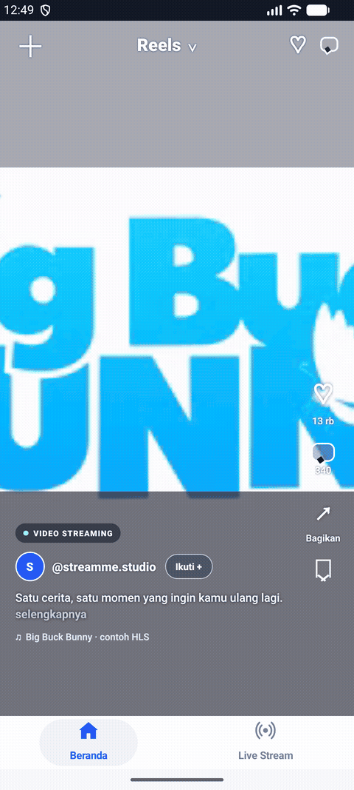
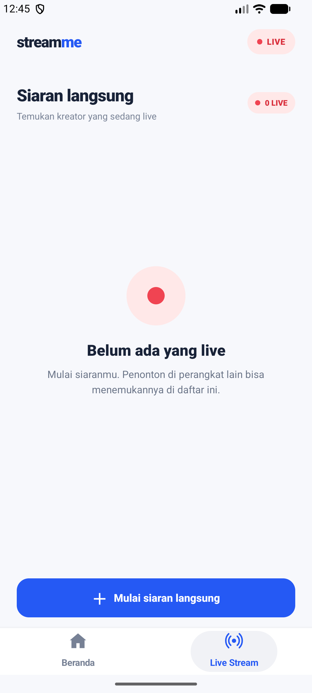

# Stream Me

Stream Me is a native iOS and Android prototype for vertical video streaming and live broadcasts. The navigation shell uses native platform code, while the Reels feed and live experience are built with React Native.

## Demo

Each real HLS video plays for four seconds before the feed swipes to the next one. The video and live streaming demos are shown side by side:

<table>
  <tr>
    <td align="center"><strong>Video streaming · swipe</strong><br></td>
    <td align="center"><strong>Live streaming</strong><br></td>
  </tr>
</table>

## Features

- Vertical, swipeable video feed with four sample HLS streams.
- Reel-style creator, caption, like, comment, share, and save controls.
- Caption detail sheet with creator details and comments.
- Live creator list with separate sessions and a start-broadcast action.
- LiveKit camera and microphone broadcast from Android, with viewers on iOS or Android.
- Native bottom navigation for **Beranda** and **Live Stream**.

## Project layout

- `App.tsx` — React Native feed, navigation state, and session joining.
- `LiveLobby.tsx`, `LiveRoom.tsx` — live session discovery and LiveKit room UI.
- `ios/StreamMe/` — native iOS app and UIKit navigation shell.
- `android/app/` — Android app and native navigation shell.
- `server/livekit/` — development token service and tests.
- `deploy/stream-me/` — Docker deployment configuration for the token service and LiveKit.
- `docs/` — product scope, live testing notes, and screenshots.

## Requirements

- Node.js 22.11 or newer.
- Xcode and iOS Simulator for iOS builds.
- Android Studio, Android SDK, and an emulator or device for Android builds.
- CocoaPods for iOS dependencies.

## Install and run

```sh
npm install
cd ios && pod install && cd ..
npm start
```

In a second terminal, run either platform:

```sh
npm run ios
# or
npm run android
```

Open **Live Stream** to browse available broadcasts or start one on Android. Open **Beranda** to swipe through the video feed. The included HLS URLs are public demo streams and can change independently of this project.

## Live streaming backend

Replace `your_public_ip` in `liveConfig.ts` and the iOS ATS domain entry in `ios/StreamMe/Info.plist` with the public IP of your server before testing live features. For local development, follow [docs/live-local.md](docs/live-local.md). The included token service uses development credentials by default and does not provide user authentication. Do not use the demo configuration for a production service; configure a secured LiveKit deployment and authenticated token issuance first.

## Checks

```sh
npm run lint
npx tsc --noEmit
npm test -- --runInBand
npm run test:live-token
cd android && ./gradlew :app:assembleDebug
```

Build the iOS simulator target with the `StreamMe` scheme in `ios/StreamMe.xcodeproj` or `ios/StreamMe.xcworkspace`.
